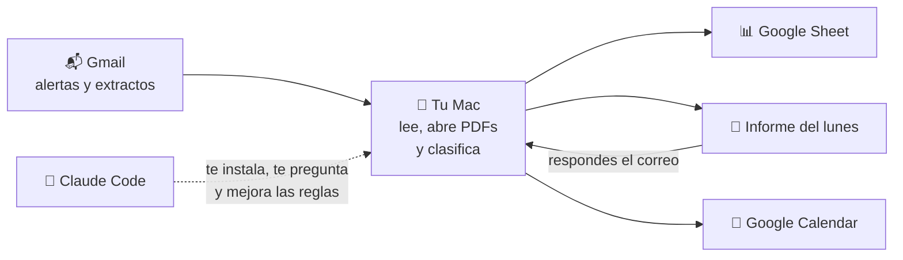

<div align="center">

# 🧾 Mis Finanzas Personales Tracker+

### Chatea con tu plata.

**Pregúntale a tu economía lo que quieras y te responde con tus números reales.**
Lee los correos de tus bancos, organiza cada peso en un Google Sheet y tú solo conversas: *¿cuánto puedo gastar?, ¿me alcanza para el viaje?, ¿en qué se me fue la plata?*


</div>

---

## 💬 Chatea con tu presupuesto (y con toda tu economía)

Esto no es otra app con gráficas que nadie mira. Es un **asistente que conoce cada movimiento de tus cuentas**, tus deudas, tus pagos fijos y tus metas, y con el que hablas como con un amigo que sabe de finanzas:

> **Tú:** ¿cuánto puedo gastar hasta el sueldo?<br>
> **Claude:** Tienes **$1.673.000 libres** después de pagar la tarjeta ($615.298, vence el 25) y Addi ($119.900). Son **$209.000 por día** durante 8 días.

> **Tú:** ¿me alcanza para un viaje de $3 M en diciembre?<br>
> **Claude:** Sí, si guardas $750.000 de cada sueldo desde noviembre. A tu ritmo actual de restaurantes ($1,4 M/mes) no te alcanza: bajándolo a $900.000 lo logras sin tocar tu colchón.

> **Tú:** ¿en qué se me fue la plata este mes?<br>
> **Claude:** Gastaste $6,3 M en el día a día: comida $1,2 M, transporte $975.000, y $2,4 M en transferencias que no sé qué son. ¿Me cuentas qué fueron las de $450.000 y $390.000?

> **Tú:** eso de $450 mil fue el arriendo del parqueadero<br>
> **Claude:** Listo, lo pasé a Vivienda y creé una regla: la próxima vez lo clasifico solo.

> **Tú:** me acaban de pagar, ¿qué pago primero?<br>
> **Claude:** Primero el arriendo ($1.800.000, vence el 5) y la luz ($180.000). La tarjeta vence el 25: déjala apartada ($500.000). Con eso te quedan **$96.000 por día** hasta el 30.

> **Tú:** si abono $1 M extra al mes a la tarjeta, ¿cuándo salgo de deudas?<br>
> **Claude:** En **mar-2028** en vez de nov-2030, y te ahorras **$8,4 M** en intereses. Te conviene abonar primero al crédito del 28% E.A., no al del 12%.

*(conversaciones y cifras de ejemplo)*

Y como todo vive en tu Google Sheet, **también puedes chatear desde el celular**: con Claude en el teléfono y el conector de Google Drive, le preguntas a tu economía desde cualquier parte.

## 📅 Tus pagos, tu presupuesto y tus deudas, en piloto automático

**Nunca más se te pasa una factura.** Cada pago (arriendo, servicios, tarjetas, créditos) queda en tu **Google Calendar** con aviso **3 días antes y 1 día antes**, por notificación y por correo:

| En tu calendario | Cuándo te avisa |
|---|---|
| 💳 **Vence: Arriendo — $1.800.000** | 3 días antes y el día anterior, 9:00 a. m. |
| 💳 **Vence: Tarjeta (pago total)** | Con el valor del último extracto |
| 🔁 **Hipoteca — $1.200.000 (sale solo)** | Para que sepas, sin alarma |
| 💰 **Llega el sueldo** | Con la lista de todo lo que pagas ese mes |

**El día que te pagan, te escribe:**

> ### 💰 ¡Hoy te pagaron!
> Llegaron **$6.500.000**. Próximo sueldo: 30 nov (31 días).
>
> **1. Paga esto antes del próximo sueldo — $3.120.000**
> 5 nov · Arriendo $1.800.000 · 5 nov · Luz $180.000 · 15 nov · Crédito libre inversión $640.000 · 25 nov · Tarjeta $500.000
>
> **2. Aparta esto — $400.000** · Ahorro para la renta
>
> **Te queda libre: $2.980.000 → $96.000 por día** 🟢

*(cifras de ejemplo)*

**Y conoce tus deudas mejor que tú.** Lee las tasas directamente de tus extractos y te dice cuánto te cuesta cada una:

| Deuda | Saldo | Tasa E.A. | Intereses al mes |
|---|---|---|---|
| Tarjeta | $1.300.000 | 28,47% | paga el total |
| 👉 Libre inversión | $20.000.000 | 24,10% | $363.000 |
| Vehículo | $35.000.000 | 15,20% | $414.000 |
| ICETEX | $18.000.000 | 5,10% | $75.000 |

> 👉 *Si te sobra plata, abónala a Libre inversión (24,10% E.A.): cada $1.000.000 te ahorra ≈ $241.000 de intereses al año. No abones extra al ICETEX: es tu deuda más barata.*

## ¿Qué hace?

- 📬 **Lee tu Gmail**: alertas y extractos de Davivienda, Nu, Bancolombia, Addi… (las claves de los PDF las abre solo).
- 🗂️ **Clasifica todo**: comida, transporte, arriendo, viajes, deudas… y no cuenta dos veces los pagos de tarjeta ni los traslados entre tus cuentas.
- 📊 **Arma tu Google Sheet**: resumen mensual, gastos por categoría, calendario de pagos, suscripciones, proyección de deudas y de caja.
- 💌 **Te escribe cada lunes**: cuánto puedes gastar por día hasta el sueldo, qué tienes que pagar y en qué se te fue la plata esa semana.
- 🙋 **Te pregunta lo que no entiende**: le respondes el correo (`3: mercado`) y aprende para la próxima.
- 🔁 **Se actualiza solo** cada vez que prendes tu Mac.

## Así se ve el informe del lunes

> **Tu semana financiera — 26 oct**
>
> ### 💸 Puedes gastar **$209.000 por día** hasta el sueldo (29 oct)
> $1.673.000 libres = disponible en tu cuenta − $835.000 de pagos pendientes antes del sueldo.
>
> **Antes del sueldo tienes que pagar:** tarjeta $615.298 (25 oct) · Addi $119.900 (24 oct)
>
> **Esta semana gastaste $2.577.000** — techo semanal $2.055.000 ❌ te pasaste por $522.000
>
> **✍️ Responde este correo:** `1: mercado` · `2: préstamo a un amigo` · `Nequi: 120 mil`

*(cifras de ejemplo)*

## ¿Cómo funciona?



Todo corre **en tu computador** con **tu cuenta de Google**. No hay servidores de terceros ni nadie más ve tus datos.

---

## 🚀 Empieza en 3 pasos (≈ 1 hora la primera vez)

**Necesitas:** un Mac · un Gmail donde te lleguen los correos de tus bancos · [Claude Code](https://claude.com/claude-code) (plan Pro o Max).

**1. Instala Claude Code** (si no lo tienes)
```bash
curl -fsSL https://claude.ai/install.sh | bash
```

**2. Descarga Mis Finanzas Tracker+ y ábrelo con Claude**
```bash
cd ~/Documents
git clone https://github.com/javierherrera1996/mis-finanzas-personales-tracker.git
cd mis-finanzas-personales-tracker
claude
```

**3. Escríbele: `hola, instálalo`**

Eso es todo. Claude te entrevista, corre los comandos y te guía en lo que haya que hacer en el navegador.

### Lo que Claude te va a preguntar

| | Fase | Qué pasa |
|---|---|---|
| 1 | **Requisitos** | ¿Mac? ¿A qué Gmail te llegan los bancos? ¿Recibes extractos en PDF? ¿Usas billeteras como RappiCuenta, Nequi o Lulo? |
| 2 | **Tus datos** | Nombre, correo, clave de los PDF (casi siempre tu cédula), cómo te pagan y cuánto te llega, techo de gasto, si compartes gastos con alguien |
| 3 | **Google** | Te guía clic a clic para crear tu acceso a Gmail y Sheets ([detalle](docs/google-cloud.md)) |
| 4 | **Tus bancos** | Revisa tu Gmail, te muestra qué bancos te escriben y confirma cuáles cuentas son tuyas |
| 5 | **Primera corrida** | Baja tus correos, crea tu Sheet y te cuenta lo primero que encontró |
| 6 | **Clasificar** | Te pregunta qué son los movimientos que no entendió, de a 10 |
| 7 | **Lo fijo** | Créditos (con sus tasas), arriendo, servicios, tarjetas, suscripciones y plata apartada |
| 8 | **Automático** | Pone tus pagos en Google Calendar, activa el aviso de día de pago y el informe del lunes, y te manda uno de prueba |
| 9 | **Web y celular** *(opcional)* | Tus metas del año y el acceso desde Claude web y la app del celular |

---

## 🏦 Bancos que ya lee

| Banco / billetera | Qué lee | Estado |
|---|---|---|
| **Davivienda** | Extractos de ahorros, tarjeta y créditos (PDF) + alertas | ✅ |
| **Nu** | Extractos de tarjeta (PDF) y saldo de la Cuenta Nu + cajitas | ✅ |
| **Bancolombia** | Alertas por correo (compras, transferencias, QR) | ✅ |
| **Addi** | Extractos | ✅ |
| RappiCuenta, Nequi, Lulo, BBVA, otros | — | 🛠️ Claude lo agrega durante la instalación |

¿Tu banco no está? En la fase 4 Claude lo detecta y le escribe el lector.

## 🌐 Úsalo desde Claude web y el celular

Tu Mac hace el trabajo pesado (lee los correos, clasifica, calcula) y deja todo en tu Google Drive. Desde cualquier lugar le preguntas a Claude:

| En tu Drive | Para qué |
|---|---|
| 📄 **Mi economía — contexto para Claude** (Google Doc) | **Todo tu contexto en un solo texto**: foto de hoy, pagos de los próximos 30 días, deudas con tasas, flujo de 12 meses, gasto por categoría, ingresos, suscripciones, plan y los movimientos de los últimos 60 días. Claude lo lee completo |
| 📊 **Finanzas Personales** (Sheet) | El detalle y las gráficas, para ti |
| 🎯 **Plan y estrategia** (Sheet) | Tus metas y hoja de ruta |

**Para configurarlo (una vez):**
1. En [claude.ai](https://claude.ai) → **Configuración → Conectores** → conecta **Google Drive** con la misma cuenta.
2. Crea un **Proyecto** "Mis finanzas" y en sus instrucciones pega: *"Antes de responder, lee en Google Drive el documento 'Mi economía — contexto para Claude' y responde solo con esas cifras."*
3. Listo: desde la web o la app del celular, entra al proyecto y pregúntale lo que quieras.

El Doc se regenera cada día que prendes tu Mac, así que Claude siempre ve tus números de ese día. *(Por qué un Doc y no el Sheet: el conector de Drive le muestra a Claude solo unas filas de cada hoja; un documento lo lee completo.)*

## 🔒 Privacidad

- Tus datos **nunca salen de tu Mac y tu Google**.
- Estos archivos son solo tuyos y **git los ignora**: `config.json` (tus datos), `credentials.json` y `token.json` (tu acceso a Google), `data/` (tus movimientos) y `pdfs/` (tus extractos).
- **No los compartas con nadie**, ni por chat ni subiéndolos a internet.
- El acceso a Gmail es de **solo lectura**. El único correo que el sistema envía es tu informe, a ti mismo.

## 🗣️ El día a día

Abre Claude en la carpeta (o en el celular) y háblale normal. Algunas ideas:

| Le dices | Te responde |
|---|---|
| `actualiza` | Trae lo nuevo de tus bancos y te dice qué cambió |
| `¿cuánto puedo gastar?` | Lo que tienes libre por día hasta el sueldo, con el cálculo |
| `¿cómo voy este mes?` | Gasto contra tu techo, por categoría |
| `eso de $300 mil fue el mercado` | Lo reclasifica y crea una regla |
| `mándame el informe` | El informe del lunes, ya |
| `¿qué me toca pagar esta semana?` | Lo que vence, con montos y cómo pagarlo |
| `¿qué tasa tiene cada deuda y a cuál abono?` | Tus deudas de mayor a menor tasa y dónde rinde más un abono |
| `agrega la factura del gas, $80 mil el día 12` | La agrega al calendario de pagos y a tu Google Calendar |
| `¿me alcanza para X?` | Si te alcanza, cuánto ahorrar por mes y qué recortar |
| `¿qué suscripciones debería cancelar?` | Cuánto pagas en cada una y cuáles casi no usas |
| `simula que me suben el sueldo 20%` | Cómo cambian tu caja, tus deudas y tu ahorro |
| `¿cómo me fue este año?` | Informe con ingresos, gastos, deudas y recomendaciones |

O simplemente **responde el correo del lunes**.

---

<details>
<summary><b>📋 Prompts por fase</b> (si prefieres ir paso a paso en vez de "instálalo")</summary>

**1 — Instalar y configurar**
```
Lee CLAUDE.md y README.md. Corre ./instalar.sh y después crea mi config.json a partir de config.ejemplo.json preguntándome los datos uno por uno. Explícame para qué sirve cada dato.
```
**2 — Credenciales de Google**
```
Guíame paso a paso con docs/google-cloud.md para crear credentials.json con MI cuenta. Un paso a la vez, espera mi confirmación. Cuando tenga el archivo, corre reautorizar.py y dime qué hacer en el navegador.
```
**3 — Primera actualización**
```
Corre detectar_bancos.py y luego actualizar.py. Dame el enlace del Sheet, dime qué bancos me escriben que el sistema NO lee, y resúmeme cuánto me entró y cuánto gasté por mes.
```
**4 — Mis bancos**
```
Agrega los bancos o billeteras que no está leyendo (skill finanzas-nueva-fuente), empezando por los que mandan extractos en PDF.
```
**5 — Clasificar**
```
Muéstrame los movimientos más grandes sin clasificar, agrupados, y pregúntame qué son de a 10. Crea reglas con mis respuestas y regenera el Sheet.
```
**6 — Lo fijo**
```
Configura conmigo mis créditos, pagos fijos, suscripciones y plata apartada para que el Sheet tenga calendario de pagos y cuánto puedo gastar por día.
```
**7 — Automático**
```
Corre ./instalar.sh automatico, verifica el servicio y mándame un informe de ejemplo hoy.
```
**8 — Celular y plan** *(opcional)*
```
Llena data/plan.json conmigo (objetivos y hoja de ruta), corre plan_sheet.py y crea skills para claude.ai que lean mis Sheets por Google Drive.
```
</details>

<details>
<summary><b>🧯 Si algo falla</b></summary>

| Mensaje | Qué hacer |
|---|---|
| `invalid_grant` | Tu app de Google quedó en modo "Prueba" (vence cada 7 días). Publícala y corre `.venv/bin/python reautorizar.py` |
| `has not been used in project` / `SERVICE_DISABLED` | Falta habilitar esa API en Google Cloud |
| `NO ABRE` un PDF | La `clave_pdf` de config.json no es la correcta |
| No llega el informe del lunes | `tail data/revisiones.log` y `launchctl list \| grep misfinanzas` |
| Cualquier otro | Pégale el error a Claude tal cual |

Desactivar el servicio automático: `launchctl unload ~/Library/LaunchAgents/com.misfinanzas.actualizar.plist`
</details>

<details>
<summary><b>🧩 Qué hay en este repo</b></summary>

| Archivo | Para qué |
|---|---|
| `actualizar.py` | El proceso completo: correos → PDFs → clasificación → Sheet → informe |
| `build.py` | Reglas de clasificación (las tuyas van en `config.json → reglas_personales`) |
| `agente.py` | Los cálculos: caja, días al sueldo, pagos pendientes, cuánto gastar por día |
| `make_sheet.py` / `plan_sheet.py` | Los Google Sheets |
| `contexto_doc.py` | El Google Doc con todo tu contexto para Claude web y el celular |
| `informe_semanal.py` / `respuestas.py` | El correo del lunes y la lectura de tus respuestas |
| `dia_de_pago.py` | El correo "hoy te pagaron: paga esto y te queda tanto libre" |
| `deudas.py` | Tus deudas con tasas, intereses al mes y dónde abonar |
| `calendario.py` | Tus pagos en Google Calendar con avisos antes de vencer |
| `detectar_bancos.py` | Qué bancos te escriben y cuáles faltan |
| `parse_*.py` | Lectores de cada banco |
| `.claude/` | Skills y reglas para que Claude te instale y te ayude |
| `config.ejemplo.json` / `data_inicial/` | Plantillas que se llenan con tus datos |

Más detalle técnico en [docs/como-funciona.md](docs/como-funciona.md).
</details>

---

<div align="center">
<sub>Hecho con 🤖 Claude Code · Mejoras: <code>git pull</code> (tus datos no se tocan)</sub>
</div>
